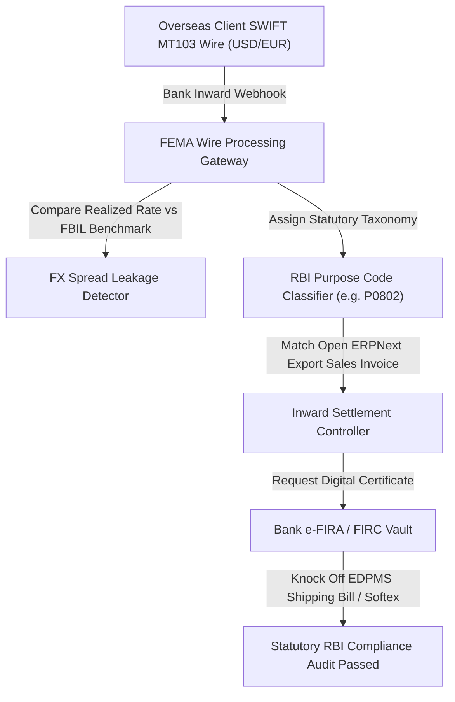

# Frappe Cross-Border Wire & FEMA Inward Remittance (FIRC / e-FIRA) Engine

[](https://frappeframework.com/)
[]()
[]()
[]()
[](LICENSE)

## 📌 Executive Overview & Real-World Client Problem

Indian software exporters, consulting firms, and cross-border merchants receiving international wire payments (SWIFT MT103 / ISO 20022) face strict **Foreign Exchange Management Act (FEMA)** mandates enforced by the Reserve Bank of India (RBI):
1. **Unallocated Inward Remittances:** Millions of rupees sit in Nostro suspense accounts because bank treasury desks require correct **RBI Purpose Codes** (e.g. `P0802` for software exports, `P0102` for physical goods).
2. **Missing e-FIRA / FIRC Documentation:** Without an electronic Foreign Inward Remittance Advice (e-FIRA), statutory export turnover cannot be reconciled, causing GST zero-rated refund rejections and Directorate General of Foreign Trade (DGFT) notices.
3. **Hidden Bank FX Markup Spreads:** Authorized Dealer (AD Category-I) banks levy undisclosed 0.5%–1.5% exchange rate markups over FBIL reference benchmark rates.

This Frappe application unifies SWIFT wire ingestion, RBI Purpose Code classification, e-FIRA vaulting, and EDPMS/IDPMS invoice write-offs.

---

## 🏛️ System Architecture Flow



---

## 🚀 Key Engineering Capabilities

- **SWIFT Wire Message Parsing:** Extracts UETR, remitter country, ordering customer, and realized exchange rates.
- **Bank FX Markup Auditing:** Highlights currency conversion slippage against official FBIL daily reference benchmarks.
- **Automated e-FIRA Linking:** Attaches digital remittance certificates directly to ERPNext Sales Invoices.
- **EDPMS Realization Tracking:** Verifies 9-month statutory export proceeds realization windows under FEMA regulations.

---

## 📂 Frappe DocType Schema & Data Structure

```text
fema_inward_remittance/
├── fema_inward_remittance_core/
│   ├── doctype/
│   │   ├── inward_remittance_wire/
│   │   │   ├── inward_remittance_wire.json
│   │   │   ├── inward_remittance_wire.py
│   │   │   └── inward_remittance_wire.js
│   │   └── efira_document_vault/
│   │       └── efira_document_vault.json
│   └── workspace/
│       └── fema_inward_remittance_workspace/
│           └── fema_inward_remittance_workspace.json
```

---

## ⚡ Frappe Hooks & Whitelisted APIs

- **REST Endpoint:** `POST /api/method/fema_inward_remittance.api.process_incoming_wire`
- **Whitelisted Method:** `@frappe.whitelist() def allocate_fira_and_settle_invoice(wire_ref, invoice_no, rbi_purpose_code, fira_no)`
- **Hooks Event:** `on_submit` of `Payment Entry` (Inward) checks for valid RBI purpose code tagging.

---

## 🛠️ Installation & Bench Setup

```bash
bench get-app https://github.com/shyampandey1104/frappe-cross-border-wire-fema-inward-remittance
bench --site erp.yourdomain.com install-app fema_inward_remittance
bench --site erp.yourdomain.com migrate
python3 -m unittest discover tests
```

---

## 📄 License
MIT License. Tailored for IT Exporters, Cross-Border E-Commerce, and Export Houses.
